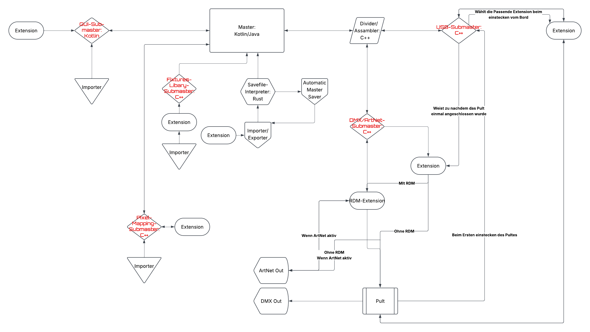

# ArchX

An lighting software framework designed to work with modern and legacy digital lighting consoles through expansion slots.

ArchX is built around a central Master state model and specialized Submasters that handle hardware, protocols, rendering, UI, and file import/export. This architecture keeps the system modular while ensuring all parts work from the same show state.

## Key Features

- Modular architecture with a central Master and pluggable Submasters
- Support for modern and legacy digital lighting consoles via expansion slots and hardware driver extensions
- USB console integration with automatic driver detection and bidirectional data tunneling
- DMX and Art-Net output with optional RDM support
- Pixel mapping and DyLOS-compatible value generation from the Master 2D list
- Consistent show state in memory with GUI updates mirrored from the Master
- Save and autosave of showfiles in the `.archx` format
- Import and export support through extension-based showfile integrations
- Extension ecosystem for hardware, UI, fixtures, outputs, importers, exporters, and pixel mapping

## Architecture Overview

The project is split into a Master, which keeps the full showfile state in RAM, and multiple specialized Submasters for hardware, interfaces, and processing. The system is designed so that hardware-specific logic, file formats, and fixture libraries stay isolated behind extensions.

### Main Components

| Component | Language | Responsibility |
| --- | --- | --- |
| Master | Kotlin | Holds the showfile state in RAM and manages all submasters |
| GUI-Submaster | Kotlin | User interface, configurable via UI extensions |
| Divider / Assembler | C++ | Bundles incoming events into status frames and distributes commands to USB and DMX submasters |
| USB-Submaster | C++ | Detects attached consoles, loads the correct driver extension, and tunnels data bidirectionally |
| DMX / Art-Net-Submaster | C++ | Sends DMX frames in a 44 Hz loop and optionally supports RDM |
| Pixel-Mapping-Submaster | C++ | Generates pixel values from the Master 2D list in a DyLOS-compatible way |
| Fixtures-Library-Submaster | C++ | Manages fixture profiles, primarily the Onyx library, via extensions |
| Savefile-Interpreter | Rust | Imports `.archx` showfiles, periodically saves the Master state, and exports files via extensions |

## Signal Flow

### Input: Console to interface
Pult → USB-Submaster (driver extension) → Divider/Assembler → Master → GUI-Submaster.

### Output: DMX and Art-Net
Master → Divider → DMX-Submaster → optional RDM extension → DMX Out or Art-Net Out.

### Pixel mapping
The Master provides a 2D list to the Pixel-Mapping-Submaster, which calculates the values and returns them to the Master where they are treated like any other value source.

### Feedback to the console
The Master → Divider → USB-Submaster → driver extension → console returns LED, motor fader, and other feedback data.

### Save and load
The Savefile-Interpreter reads the Master state periodically and writes it as a `.archx` showfile. Foreign showfiles can be imported through importer extensions.

## Extension Types

- Hardware drivers for consoles
- Output modules (DMX, RDM)
- Importers and exporters for showfiles
- Fixture library sources
- Pixel mapping libraries, video, and image importers
- UI extensions

## Project Structure

- `master/` – Kotlin-based master application and core show state logic
- `interpreter/` – Rust-based savefile interpreter and persistence layer
- `native/` – C++ submasters and native runtime components
- `schema/` – Protocol and showfile schema definitions
- `docs/` – project documentation, architecture, and ADRs

## Documentation

- [Architecture overview](docs/architecture.md)
- [ADR 0001: Programming languages](docs/adr/001-sprachen.md)
- [ADR 0002: License](docs/adr/002-lizenz.md)
- [ADR 0003: Schema format](docs/adr/003-ipc-format.md)

## Technology Stack

- Kotlin – Master and UI layer
- Rust – Savefile interpreter and file handling
- C++ – Submasters, hardware interaction, DMX, and native processing
- CMake – Native build integration

## Status

ArchX is designed as a modular lighting framework that aims to bridge older and newer console ecosystems through extensible hardware and software interfaces.
